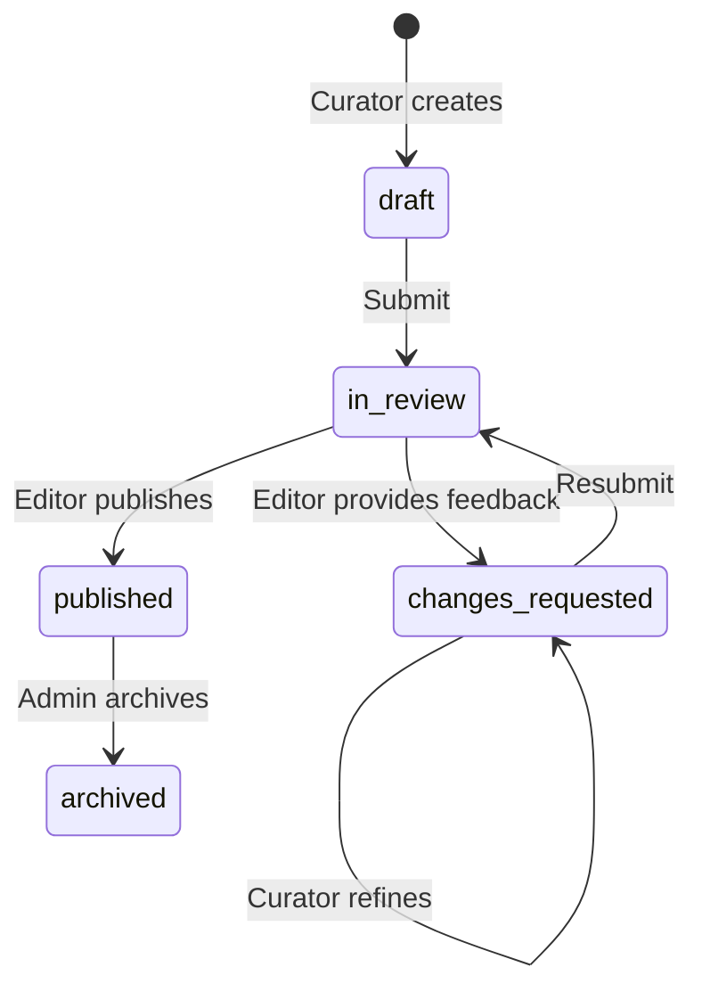
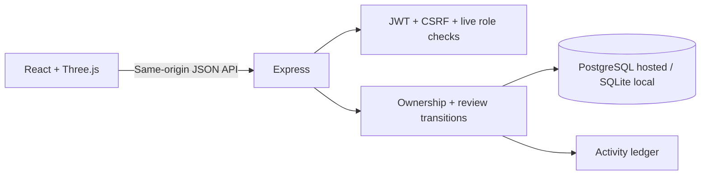

<div align="center">


# EXHIBITORA

### Some stories are forged. Never forgotten.

A cinematic digital museum where legendary objects meet interactive 3D, thoughtful curation, and secure role-based publishing.

[Explore the architecture](#architecture) · [Run locally](#run-locally) · [Permissions](#roles--permissions) · [API reference](docs/API.md)

<br />


</div>

---

## The experience

Exhibitora reimagines a museum as a space for discovery. A floating Mjolnir and Stormbreaker anchor the Asgard collection, alongside cosmic relics and royal regalia. Every artifact has an interactive display, provenance, materials, an era, and a story.

- **Original 3D displays:** six procedural Three.js models, pointer rotation, metallic surfaces, orbital details, and animated lightning on featured weapons.
- **A considered interface:** sculpted metallic controls, Manrope typography, editorial serif accents, atmospheric lighting, and light/dark themes saved on your device.
- **Discover your way:** category filters, text search, alphabetical sorting, artifact details, and a personal collection of saved discoveries.
- **Real publishing:** curators draft and refine exhibits; editors request changes or publish them; administrators govern roles and archive exhibits.
- **Responsive and accessible:** mobile navigation, responsive grids, keyboard focus, dialog focus trapping, Escape dismissal, reduced-motion support, and animation controls.
- **Secure by design:** bcrypt password hashes, signed JWTs in HTTP-only cookies, same-origin mutation checks, CSRF verification, rate-limited authentication, and server-side role checks.

## Roles & permissions

| Capability | Visitor | Curator | Editor | Admin |
|---|:---:|:---:|:---:|:---:|
| Browse published exhibits | ✓ | ✓ | ✓ | ✓ |
| Save discoveries | ✓ | ✓ | ✓ | ✓ |
| Create drafts | — | ✓ | — | ✓ |
| Edit and submit own drafts | — | ✓ | — | ✓ |
| Review all exhibits | — | — | ✓ | ✓ |
| Publish / return for changes | — | — | ✓ | ✓ |
| Archive exhibits | — | — | — | ✓ |
| Assign roles / read audit log | — | — | — | ✓ |

Browsing is public. Saving discoveries requires an account. New registrations always receive the visitor role, regardless of fields sent by the browser. Administrators cannot remove their own administrator role.



## Run locally

Requires **Node.js 24 or later** and npm.

```bash
git clone https://github.com/rachit1807/exhibitora.git
cd exhibitora
npm ci
npm run dev
```

Open the local URL printed by the server. The default port is `5173`. Development uses SQLite at `.data/exhibitora.db`, which is excluded from Git.

### Configure an administrator

Copy `.env.example` to `.env`, then set `ADMIN_EMAIL`, a strong `ADMIN_PASSWORD`, and a random `JWT_SECRET`. Never commit this file.

```bash
node --env-file=.env server/index.js
```

The administrator is created only when that email does not already exist. Existing accounts are never silently promoted. For ongoing use, create visitor accounts through the interface, then assign curator and editor roles from the administrator’s studio. Remove bootstrap credentials from your hosting environment after provisioning the administrator.

Generate a signing secret with:

```bash
node -e "console.log(require('crypto').randomBytes(48).toString('hex'))"
```

### Production mode

```bash
npm run build
NODE_ENV=production node --env-file=.env server/index.js
```

Production requires `JWT_SECRET`. Set `DATABASE_URL` to a PostgreSQL connection string for durable hosted data. Use the provider’s TLS-enabled URL; do not disable certificate verification. Set `PORT` when your host does not inject it.

| Variable | Purpose | Required |
|---|---|---|
| `DATABASE_URL` | PostgreSQL connection URL; SQLite is the local fallback | On hosted deployments |
| `JWT_SECRET` | Signs 8-hour session tokens | Production |
| `ADMIN_EMAIL` | Initial administrator email | Bootstrap only |
| `ADMIN_PASSWORD` | Initial administrator password | Bootstrap only |
| `PORT` | HTTP port, default `5173` | Optional |
| `NODE_ENV` | Set to `production` to serve the compiled frontend | Production |
| `SQLITE_PATH` | Override local database location | Optional |

## Architecture



```text
src/                 React interface, responsive styles, procedural 3D models
server/app.js        Authentication, authorization, exhibit workflow, API
server/store.js      PostgreSQL / SQLite persistence adapter
server/seed.js       Initial public collection
server/index.js      HTTP server, Vite integration, production assets
tests/               API and security regression tests
docs/                API reference and operational notes
.github/workflows/   Automated test and build checks
```

The server reads the user’s current role for every request. A role change therefore takes effect without waiting for a JWT to expire. Revision checks prevent stale editorial actions. Failed writes restore the previous in-memory state.

**Persistence scope:** this portfolio application deliberately uses a single serialized museum-state record and one server process. Run one service instance. Horizontal scaling would require normalized tables, database transactions, and shared session/rate-limit infrastructure. Back up PostgreSQL before significant operational changes. The audit ledger retains the latest 500 events.

## Validation

```bash
npm test
npm run build
```

The test suite covers unauthorized access, CSRF enforcement, draft ownership, invalid workflow transitions, revision conflicts, return/resubmission/publication, bookmarks, role revocation, archive visibility, safe registration, and HTTP-only session cookies. GitHub Actions runs these checks on pushes and pull requests.

## Deployment & data retention

The frontend and API run together as one Node.js service. PostgreSQL is a separate resource, so app restarts and deployments do not erase the collection or user accounts.

Exhibitora uses its own Neon project and database, separate from previous projects. The database’s production branch has no configured time-to-live. Neon’s free tier has usage and storage limits; exhausted compute quotas may suspend access until reset or upgrade. A free plan is not a guarantee of permanent availability. Consult the provider’s current terms and maintain backups.

Free web hosting can sleep when idle and take time to wake. Database suspension and web-service sleep are different from data deletion.

## Visual and content credits

Designed and developed by **Rachit Tripathi**. All displayed 3D models are original procedural, stylized interpretations built with Three.js. Interface icons use Lucide. Technology icons use Skill Icons. Fonts are Manrope and Playfair Display, served by Google Fonts.

Exhibitora is an independent fan and educational project, unaffiliated with Marvel, Disney, or Microsoft. Character and artifact names belong to their respective owners. No official movie models, footage, logos, or promotional artwork are included.

## License

Application source is available under the [MIT License](LICENSE). Third-party trademarks and character rights remain with their owners.
